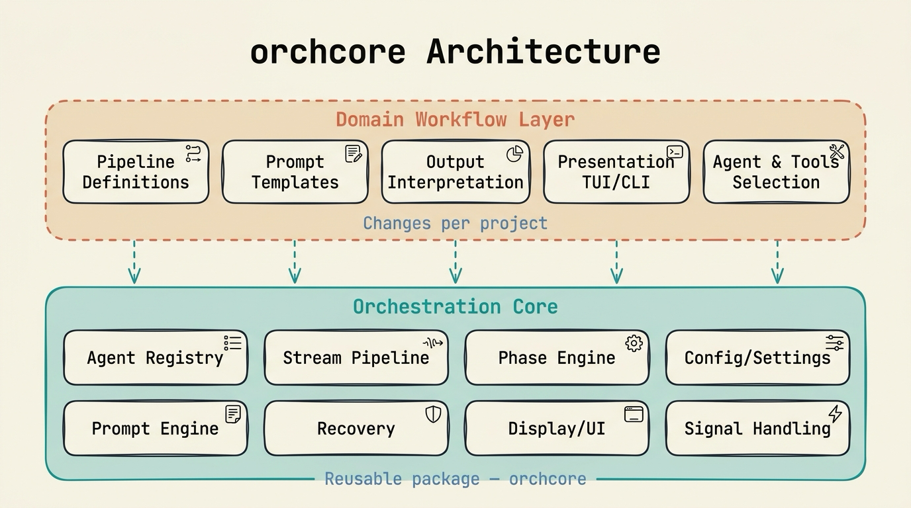

# orchcore

> Reusable orchestration core for AI coding agent CLI pipelines.

[](https://github.com/AbdelazizMoustafa10m/orchcore/actions/workflows/ci.yml)
[](https://github.com/AbdelazizMoustafa10m/orchcore/releases)
[](https://pypi.org/project/orchcore/)
[](https://www.python.org/downloads/)
[](LICENSE)
[](https://scorecard.dev/viewer/?uri=github.com/AbdelazizMoustafa10m/orchcore)
[](https://mypy-lang.org/)
[](https://docs.astral.sh/ruff/)
[](https://codecov.io/gh/AbdelazizMoustafa10m/orchcore)

## What is orchcore?

orchcore is an async-first Python library for launching, monitoring, and managing AI coding agent CLIs (Claude Code, Codex, Antigravity, Copilot, OpenCode) as subprocesses in phase-based pipelines. It was extracted from four production orchestration systems (Planora, Articles, Finvault, and Raven), where an estimated 60-70% of the orchestration code was the same infrastructure. Consuming projects keep only their domain-specific logic: pipeline definitions, prompts, output interpretation, and presentation.

<p align="center">
  
</p>

## Features

- Launches agent CLIs as async subprocesses, captures their output streams, and limits how many run at once.
- Normalizes five JSONL output formats into one `StreamEvent` model through a four-stage stream pipeline (filter, parse, monitor, stall detection).
- Runs phases in dependency order, with each phase's agents running sequentially or in parallel, and supports resume, skip, and single-phase options.
- Detects rate limits, parses reset times (including named time zones), and retries after a backoff wait.
- Layers settings from TOML files, `.env` and environment variables, constructor arguments, and named profiles.
- Separates the engine from presentation through the `UICallback` protocol, so the consuming project chooses Rich, Textual, or headless output.
- Defines agents as data: a new agent CLI that uses a supported stream format needs only a TOML entry.
- On SIGINT or SIGTERM, terminates agent process trees and force-kills them after a 30-second grace period. With a workspace attached, completed phases are saved for resume.
- Starts agent subprocesses with a filtered environment by default and in an explicit working directory when one is given (`cwd`). Git recovery runs only when a phase opts in.

## Installation

orchcore requires Python 3.12 or later.

```bash
uv pip install orchcore
```

To install from source with the development dependencies:

```bash
git clone https://github.com/AbdelazizMoustafa10m/orchcore.git
cd orchcore
uv pip install -e ".[dev]"
```

## Quick Start

### 1. Define Agents

```toml
# agents.toml
[agents.claude]
binary = "claude"
model = "claude-sonnet-4-20250514"
subcommand = "-p"
stream_format = "claude"

# Flag profiles — names are your project's workflow vocabulary, not orchcore's.
[agents.claude.flags]
plan = ["--think", "--verbose"]

[agents.claude.output_extraction]
strategy = "jq_filter"
jq_expression = ".content[0].text"
```

### 2. Run a Pipeline

<!-- example:quickstart.py:begin -->
```python
"""Minimal orchcore pipeline setup.

Requires a matching ``agents.toml`` file and the configured agent CLI on
``PATH``. Use ``dry_run=True`` at the AgentRunner layer for artifact-level
smoke tests; a real pipeline run launches the configured CLI.
"""

from __future__ import annotations

import asyncio
from pathlib import Path

from orchcore.pipeline import Phase, PhaseRunner, PipelineRunner
from orchcore.registry import AgentRegistry, ToolSet
from orchcore.runner import AgentRunner
from orchcore.ui import NullCallback


async def main() -> None:
    registry = AgentRegistry()
    registry.load_from_toml(Path("agents.toml"))

    phase = Phase(
        name="planning",
        agents=("claude",),
        # Selects [agents.<name>.flags].plan — a name YOUR project defines.
        flag_profile="plan",
        tools=ToolSet(internal=("Read", "Glob", "Grep"), permission="read-only"),
    )

    runner = AgentRunner()
    phase_runner = PhaseRunner(runner, registry, max_concurrency=4)
    pipeline = PipelineRunner(phase_runner)

    result = await pipeline.run_pipeline(
        phases=[phase],
        prompts={"planning": "Analyze the codebase and create a plan."},
        ui_callback=NullCallback(),
    )

    print(f"Success: {result.success} | Cost: ${result.total_cost_usd}")


if __name__ == "__main__":
    asyncio.run(main())
```
<!-- example:quickstart.py:end -->

By default, agent subprocesses receive a filtered environment, so common API keys and provider-specific variables are not inherited. To pass them through, set `env_policy = "inherit"`, list the names in `env_passlist`, or set explicit `env_vars` in the agent config.

## Modules

| Module | Purpose |
|--------|---------|
| `stream/` | 4-stage pipeline (Filter → Parse → Monitor → Stall Detect) for 5 agent formats |
| `pipeline/` | Phase orchestration: sequential or parallel multi-agent execution in topological dependency order |
| `runner/` | Async subprocess management with stdout/stderr streaming and optional stdin prompt transport (`prompt_via = "stdin"`) |
| `registry/` | Agent configurations as data (TOML/dict) with runtime lookup |
| `config/` | Layered settings from TOML files, profiles, `.env`, environment variables, and constructor arguments |
| `recovery/` | Rate-limit detection, exponential backoff, git dirty-tree recovery |
| `workspace/` | Artifact lifecycle management |
| `prompt/` | Jinja2 template rendering with frontmatter stripping |
| `ui/` | `UICallback` protocol for pluggable display layers |
| `signals/` | Graceful SIGINT/SIGTERM shutdown |
| `display/` | Colored stderr logging (no Rich dependency in core) |
| `observability/` | Optional OpenTelemetry integration |

## Documentation

The full documentation is published on the [orchcore documentation site](https://abdelazizmoustafa10m.github.io/orchcore/). The pages below are also readable on GitHub.

| Document | Description |
|----------|-------------|
| [Installation](doc/getting-started/installation.md) | Prerequisites, install options, extras |
| [Quick Start](doc/getting-started/quickstart.md) | Define agents, build phases, run pipelines |
| [Configuration Reference](doc/reference/configuration.md) | Full settings table, profiles, env vars |
| [Stream Events Reference](doc/reference/stream-events.md) | StreamEvent fields, types, agent states |
| [UICallback Reference](doc/reference/ui-callback.md) | Protocol methods and built-in implementations |
| [Architecture](doc/architecture/overview.md) | Package layout, core abstractions, design decisions |
| [Stream Pipeline](doc/architecture/stream-pipeline.md) | How the four stream-processing stages work |
| [Design Document](doc/architecture/design.md) | Problem statement, requirements, proposed design |
| [Writing a UICallback](doc/guides/writing-a-uicallback.md) | Build custom display layers |
| [Agent Registry](doc/guides/agent-registry.md) | TOML config, adding new agents, ToolSets |
| [Recovery & Retry](doc/guides/recovery-and-retry.md) | Rate limits, backoff, failure modes |
| [Contributing](doc/development/contributing.md) | Dev setup, code standards, testing |

## Contributing

See [CONTRIBUTING.md](CONTRIBUTING.md) for development setup, testing instructions, and code standards. Contributors follow the [Code of Conduct](CODE_OF_CONDUCT.md), and security issues are reported as described in the [security policy](SECURITY.md).

## License

orchcore is released under the [MIT License](LICENSE).
