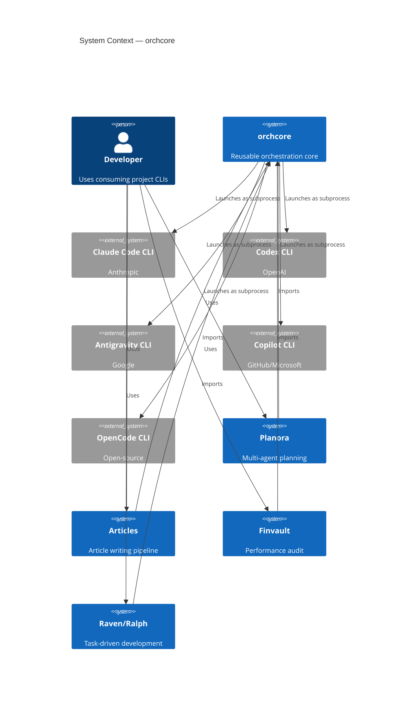
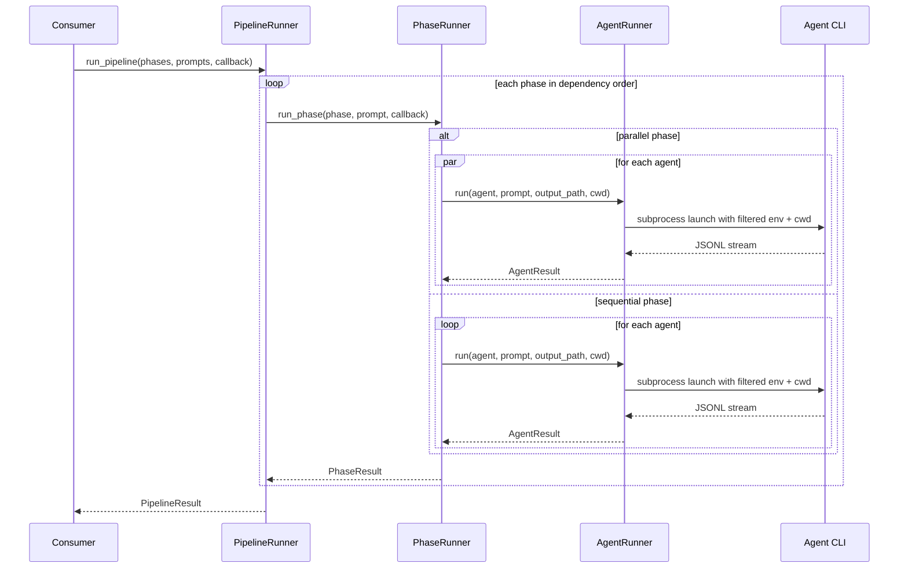

# Architecture Overview

**Version:** 1.0 | **Date:** 2026-03-25 | **Author:** Abdelaziz Abdelrasol

---

## Executive Summary

orchcore is a Python package (3.12 or later, built on asyncio) for launching, monitoring, and managing AI coding agent CLIs in phase-based pipelines. It is not an agent: it runs external agent CLIs (Claude Code, Codex, Antigravity, Copilot, OpenCode) as subprocesses.

The package was extracted from four production orchestration systems: Planora, Articles, Finvault, and Raven/Ralph. The infrastructure they shared, an estimated 60-70% of their orchestration code, moved into orchcore. Domain-specific logic (prompt content, output interpretation, presentation) stays in each consuming project.

## Key Architectural Decisions

1. The engine reports progress through the `UICallback` protocol, so each project supplies its own CLI, TUI, or headless output ([ADR-003](adrs/003-protocol-based-ui-decoupling.md)).
2. A four-stage stream processing pipeline (Filter, Parse, Monitor, Stall Detect) normalizes the different JSONL formats of the agent CLIs into one event model ([ADR-004](adrs/004-composable-stream-processing-pipeline.md)).
3. Agent configurations are data (TOML or dict) rather than classes, so a new agent CLI that uses a supported stream format needs no code changes ([ADR-007](adrs/007-registry-pattern-for-agent-management.md)).

## System Context (C4 Level 1)



## Package Layout

```
src/orchcore/
├── stream/          # 4-stage JSONL processing pipeline
│   ├── events.py    # StreamEvent, StreamFormat, AgentState models
│   ├── filter.py    # StreamFilter: pre-parse noise reduction
│   ├── parser.py    # StreamParser: dispatches each line to its format module
│   ├── formats/     # one wire-format parser per agent CLI
│   ├── monitor.py   # AgentMonitor: real-time state tracking
│   └── stall.py     # StallDetector: timeout detection
├── pipeline/        # Phase orchestration engine
│   ├── phase.py     # Phase, PhaseResult, PipelineResult models
│   ├── engine.py    # PhaseRunner: per-phase execution
│   ├── pipeline.py  # PipelineRunner: cross-phase coordination
│   └── control.py   # FlowControl: pause, resume, skip
├── runner/          # Async subprocess management
│   └── subprocess.py  # AgentRunner
├── registry/        # Agent configuration
│   ├── agent.py     # AgentConfig, ToolSet models
│   ├── registry.py  # AgentRegistry: TOML/dict lookup
│   └── versioning.py  # CLI version compatibility checks
├── config/          # Layered configuration
│   ├── settings.py  # OrchcoreSettings, load_settings_with_profile
│   └── schema.py    # AgentOverrideConfig
├── recovery/        # Rate-limit & error recovery
│   ├── rate_limit.py  # RateLimitDetector, ResetTimeParser, BackoffStrategy
│   ├── retry.py     # RetryPolicy, FailureMode
│   └── git_recovery.py  # GitRecovery
├── workspace/       # Artifact lifecycle
│   └── manager.py   # WorkspaceManager
├── prompt/          # Jinja2 templates
│   ├── template.py  # render_template, render_string, strip_frontmatter
│   └── loader.py    # TemplateLoader
├── display/         # ANSI colored logging (no Rich)
│   ├── logging.py   # log_info, log_error, status_line, phase_header
│   └── formatting.py  # format_cost, format_duration, format_tokens
├── ui/              # UICallback protocol
│   └── callback.py  # UICallback, NullCallback, LoggingCallback
├── signals/         # Graceful shutdown
│   └── handler.py   # SignalManager
├── observability/   # Optional OpenTelemetry
│   └── telemetry.py # OrchcoreTelemetry
└── __init__.py
```

## Component Diagram

```
┌─────────────────────────────────────────────────────────────────┐
│                      Consuming Project                          │
│  (Custom UICallback, Phase Definitions, Prompt Templates, TOML) │
└──────────────────────────────┬──────────────────────────────────┘
                               │
┌──────────────────────────────▼──────────────────────────────────┐
│                          orchcore                                │
│                                                                  │
│  ┌────────────┐  ┌────────────┐  ┌────────────┐  ┌───────────┐ │
│  │  pipeline/  │  │   runner/  │  │  registry/  │  │  config/  │ │
│  │ DAG phases  │─▶│ subprocess │─▶│ agent TOML  │  │  layered  │ │
│  │ seq/parallel│  │  async I/O │  │   lookup    │  │  settings │ │
│  └─────┬──────┘  └─────┬──────┘  └─────────────┘  └───────────┘ │
│        │               │                                         │
│  ┌─────▼───────────────▼──────────────────────────────────────┐ │
│  │                    stream/ (4-stage pipeline)               │ │
│  │  JSONL ─▶ Filter ─▶ Parse ─▶ Monitor ─▶ Stall Detect      │ │
│  └────────────────────────────────────────────────────────────┘ │
│                                                                  │
│  ┌──────────┐ ┌──────────┐ ┌─────────┐ ┌──────────┐ ┌────────┐│
│  │recovery/ │ │workspace/│ │ prompt/ │ │ signals/ │ │  ui/   ││
│  │rate-limit│ │ artifact │ │ Jinja2  │ │ graceful │ │Protocol││
│  │retry,git │ │lifecycle │ │templates│ │ shutdown │ │callback││
│  └──────────┘ └──────────┘ └─────────┘ └──────────┘ └────────┘│
└──────────────────────────────────────────────────────────────────┘
```

## Core Abstractions

### Pipeline Execution Model

Execution has three levels:

1. `PipelineRunner` runs the phases in topological dependency order: dependencies first, with declaration order kept among independent phases ([ADR-010](adrs/010-topological-phase-ordering-and-success-semantics.md)). It handles the resume, skip, and only-phase options. A required phase whose dependencies are unmet fails the pipeline instead of counting as a success.
2. `PhaseRunner` executes a single phase. It launches the phase's agents sequentially or in parallel through `AgentRunner`, enforces the concurrency limit, and aggregates the results.
3. `AgentRunner` launches each subprocess with an explicit command, a filtered environment, an optional working directory, and a stream parser, and terminates the whole process tree on shutdown.



### Stream Processing Pipeline

Every line of JSONL output passes through four stages:

1. `StreamFilter` drops high-volume lines with plain string matching before `json.loads()` runs (an estimated 95% of lines in typical Claude output).
2. `StreamParser` turns each remaining line into normalized `StreamEvent` instances, using one parser module per format.
3. `AgentMonitor` tracks the agent's state (a nine-state machine), tools, cost, and tokens.
4. `StallDetector` injects a synthetic `STALL` event when the agent is silent for longer than the timeout.

[Stream Pipeline](stream-pipeline.md) describes each stage.

### Tool Resolution Order

For each agent in a phase, the effective ToolSet is the first one found in this order (from highest to lowest priority):

```
Phase.agent_tools[agent]  >  explicit toolset  >  Phase.tools  >  none
```

Flag profiles (`AgentConfig.flags`, selected via `Phase.flag_profile` or the
`run_pipeline` fallback) are independent of this resolution: a selected
profile's flags are always applied, and the ToolSet translation (when one
resolves) is appended after them.

See [ADR-009: Tool assignment as phase-level concern](adrs/009-tool-assignment-as-phase-level-concern.md) and [ADR-011: Consumer-defined flag profiles](adrs/011-consumer-defined-flag-profiles.md).

## Design Principles

| Principle | How It's Applied |
|-----------|-----------------|
| Composability | Each of the 12 modules can be used on its own |
| Extensibility | A new agent CLI with a supported stream format needs only TOML configuration |
| Reliability | Configurable partial-failure semantics; optional integrations degrade to no-ops |
| Performance | Design targets of < 5 ms per event and < 100 ms per subprocess launch |
| Type Safety | mypy strict, with Pydantic validation at the public boundaries |
| Async-First | Stdlib asyncio only, with explicit task creation, fail-fast waits, and gather-based result collection |
| Protocol-Based DI | `UICallback` is a Protocol, not a base class |
| Registry-as-Data | Agents are defined in TOML or dicts, not as classes |

## Quality Attributes

| Priority | Attribute | Target |
|----------|-----------|--------|
| 1 | Extensibility | New agent CLI via TOML only |
| 2 | Reliability | Graceful degradation under partial failure |
| 3 | Composability | Each component usable standalone |
| 4 | Performance | Stream < 5ms/event, launch < 100ms |
| 5 | Type Safety | mypy strict, zero errors |

## Constraints

- Python 3.12 or later, for `tomllib`, modern type syntax, and current asyncio APIs.
- asyncio only: no trio, gevent, or threading.
- Four core dependencies: pydantic >= 2.10, pydantic-settings >= 2.7, jinja2 >= 3.1, and tzdata >= 2024.1.
- orchcore handles no agent API keys; each agent CLI manages its own authentication.
- Signal handling uses event-loop handlers where available and falls back to classic `signal.signal()` handlers on Windows.

## Related

- [Design Document](design.md): problem statement, requirements, and key interfaces
- [Stream Pipeline](stream-pipeline.md): the four stream-processing stages
- [Architecture Decision Records](../index.md#architecture-decision-records): the list of all 11 ADRs
